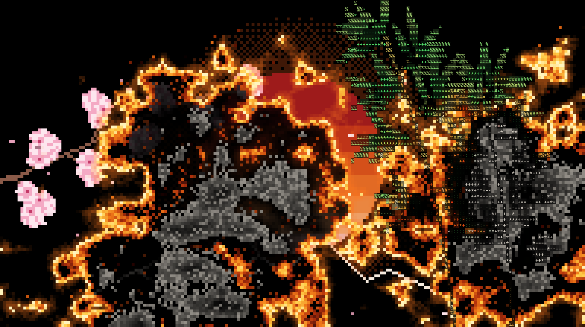

# screensaver

A pixelated terminal screensaver for Omarchy: **Sakura & Bamboo**. It shows a
banded sun, ridges, swaying bamboo drawn as ASCII glyphs, and a blossom branch
drawn as half-block pixels, with petals falling. Each cycle ends with the
scene burning to ash. It then flashes back in with the next palette: ember,
moon or dusk.




The image is inspired by the cover of Tycho's album
[*Back to Mine: Tycho*](https://tycho.bandcamp.com/album/back-to-mine-tycho).
It was first prototyped as an SVG artifact
(<https://claude.ai/artifact/Ja1FUUE8hcua8TN6aTFWiW>), and every
implementation here ports that scene.

There are five implementations of the same program. Python is the reference;
the C, Go, Zig and Odin ports were written from `docs/spec.md`.

## Quick start (Linux)

```sh
make            # install toolchains (mise) and Python deps (uv), then build everything
make test       # every test suite
make bench      # time all five on the same workload (tools/bench.py)
make stats      # regenerate the code-size table below (tools/stats.py)
```

**Prerequisites.**
- `mise` installs the toolchains pinned in `mise.toml`: Go, Zig, Odin and uv.
- uv puts numpy, Pillow and pytest into `python/.venv`.
- A system C compiler and `make` are also needed.

Starting from a clean tree with the toolchains already downloaded,
`make` takes about 22 s.

**Running.** Run any of these binaries in a terminal. Any key quits.

| impl | run |
|---|---|
| python | `bin/saver` |
| c | `c/saver` |
| go | `go/saver` |
| zig | `zig/zig-out/bin/saver` |
| odin | `odin/saver` |

All of them take these flags:

    --fps N (24)   --live S (24)   --burn S (9)   --palette ember, moon or dusk
    --max-seconds S (0 = forever)

For a headless still frame, Python takes `--png FILE`; the ports take
`--still FILE` (PNG in Go, PPM in the rest). `tools/shoot.sh` runs any of them
in a real Alacritty on a private X display and screenshots it:

    SAVER=$PWD/zig/zig-out/bin/saver SHOTS="4 14" tools/shoot.sh shots/x --live 8

## Comparison

These numbers come from this machine (Ryzen 7 8745HS), measured on 2026-11-18.

### Toolchains, dependencies, output

| impl | toolchain | dependencies beyond the language | binary | linking | clean build |
|---|---|---|---|---|---|
| python | Python 3.14 (uv venv) | numpy 2.5, Pillow 13 (pytest for tests) | n/a (interpreted) | n/a | n/a |
| c | system gcc 16, C11, make | libc, libm | 64 KB | dynamic (libc, libm) | 0.8 s |
| go | Go 1.27.4 (mise) | none: standard library only, `syscall` for termios/ioctl | 3.2 MB | static | 2.0 s |
| zig | Zig 0.17.1 (mise), `build.zig` | none: std only | 4.8 MB (not stripped) | static | 13.1 s |
| odin | Odin dev-2026-11a (mise), make | none: `core:`/`base:` only | 396 KB | dynamic (libc, libm) | 3.1 s |

Notes:
- **Clean build.** C and Odin builds start from nothing. Go uses `-a`, which
  rebuilds everything except the toolchain itself. Zig's time is with its
  cache removed.
- **Zig binary.** ReleaseFast keeps debug info. `-Dstrip` would shrink it a lot.

### Code size

From `make stats`. Lines are split by simple comment rules. Test code is
counted separately, including Zig's inline `test` blocks.

| impl | files | code | comments | blank | test code |
|---|---:|---:|---:|---:|---:|
| python | 9 | 606 | 59 | 119 | 45 |
| c | 17 | 1750 | 38 | 182 | 204 |
| go | 13 | 1498 | 123 | 172 | 303 |
| zig | 9 | 1623 | 107 | 203 | 275 |
| odin | 10 | 1662 | 107 | 175 | 133 |

Python is about a third the size of the others because numpy and Pillow do the
heavy work: polygon and line rasterising, whole-image arithmetic for the burn,
and the cell conversion as array operations. Every port has to write its own
rasteriser, PRNG, value noise and per-pixel loops. Those account for most of
the ~1,000 extra lines.

### Speed and memory

From `make bench`. Each binary runs in a pseudo-terminal of 240x67 cells
(240x134 pixels) at an unlimited frame rate for 10 s, through grow, live and
burn. Frames are counted from the output, so each figure covers the whole
path: simulate, convert to cells, build the ANSI and write it to the tty.

| impl | frames/s | ms/frame | MB/s to tty | peak RSS MB |
|---|---:|---:|---:|---:|
| python | 128 | 7.81 | 15.4 | 53 |
| c | 1,936 | 0.52 | 128.5 | 17 |
| go | 935 | 1.07 | 88.7 | 20 |
| zig | 2,233 | 0.45 | 138.5 | 20 |
| odin | 1,376 | 0.73 | 98.5 | 21 |

At the real 24 fps, every implementation is idle almost all the time. Python
uses about a fifth of a core; the ports use about 1-3% of a core.

## Review notes

**Shared design.** The modules are the same in every implementation: palettes,
scene, burn, show, render (cells and ANSI) and terminal. Each scene builds a
tree of sway nodes once. Each frame it transforms every point, rasterises with
no antialiasing, and draws a glyph mask for the bamboo. The renderer turns a
cell into a glyph where the mask is set and into a `▀` half-block elsewhere,
and redraws only changed cells inside synchronized updates. Signal handlers
only set flags (or Go's `signal.Notify` channel). Every exit path, including a
key press, SIGINT, SIGTERM and SIGHUP, restores the terminal.

**Not pixel-identical.** Each port uses its own seeded PRNG, so the bamboo and
blossoms grow slightly differently from Python's. The spec allows this.

**Per implementation:**

- **Python** (`python/`)
  - Reference implementation; tidied up in the review.
  - Removed: the unused `--mode`/`--scene`/`--once` options, a broken `--mouse`
    flag, and dead aliases.
  - Split the phase machine (`show.py`) from the CLI (`main.py`).
  - Added `pyproject.toml` and tests.
- **C** (`c/`)
  - One `.c`/`.h` pair per module, with `x_new`/`x_free` pairs.
  - xoshiro256** for random numbers.
  - The only mutable globals are `sig_atomic_t` flags.
  - Zero warnings with gcc and clang; the tests are clean under
    ASan and UBSan (848 checks).
  - Fixed in review: `--fps` was capped at 240 for no reason, numbers were
    parsed with unchecked `atoi`/`atof`, and the read-loop exit test was
    convoluted.
  - Adds a `--seed` flag.
- **Go** (`go/`)
  - Layout: `cmd/saver`, plus `internal/{scene,burn,show,render,term,pix}`.
  - `math/rand/v2` with sources passed in explicitly.
  - Errors are returned rather than panicked. The one exception is a `panic`
    on a bad palette literal, which is a compile-time constant.
  - Termios and window size go through raw `syscall` rather than
    `golang.org/x/term`, which keeps it dependency-free at the cost of a
    little code.
  - Keys are read in a goroutine and handled with a `select` alongside the
    frame timer and signals.
  - The slowest of the compiled ports, at about 1 ms a frame. Its own
    benchmark agrees, so this isn't measurement overhead. I haven't profiled
    it; the likely causes are per-pixel float64 work and missed bounds-check
    elimination.
- **Zig** (`zig/`)
  - Explicit allocators. `std.heap.DebugAllocator` in `main` checks for leaks
    on exit, and the tests use `std.testing.allocator`.
  - `defer`/`errdefer` throughout; tests sit next to the code.
  - The fastest port, partly from f32 maths and a custom 24-bit float PRNG
    (`Random.float` was slow per pixel).
  - Bad flags print an error name (`BadValue`) rather than which flag was
    wrong.
  - Adds `--bench`.
  - Std API changes in 0.17 the agent hit:
    - `main(init: std.process.Init)`;
    - I/O goes through `std.Io`;
    - `std.posix` lost `write`, `ioctl` and `clock_gettime`;
    - `ArrayList` is unmanaged.
- **Odin** (`odin/`)
  - One package, one file per module.
  - Built with `-vet -strict-style`. The tests fail on any leak
    (`ODIN_TEST_FAIL_ON_BAD_MEMORY`), and the debug build uses a tracking
    allocator in `main`.
  - `core:sys/posix` has no `ioctl` or `winsize`, so it uses
    `core:sys/linux`.
  - Constants can't be indexed by a variable, so they are copied to locals
    first.
  - Fixed in review: the frame wait always slept at least 1 ms, even when the
    frame was already late. That capped it near 600 frames/s; it now reaches
    ~1,400.
  - Adds `--bench`.

## Layout

| path | what |
|------|------|
| `python/` | reference implementation and tests |
| `c/`, `go/`, `zig/`, `odin/` | ports, each with its own README |
| `docs/spec.md` | implementation spec for ports (Python is normative) |
| `docs/notes.md` | how Omarchy's screensaver works, integration plan, Brogue findings, decisions |
| `mise.toml` | pinned toolchains |
| `Makefile` | top-level setup, build, test, bench, stats |
| `bin/saver` | runs the Python implementation |
| `tools/` | `shoot.sh` (screenshots on a private X display), `bench.py`, `stats.py` |
| `attic/` | code kept from a dropped coast scene (not used) |
| `docs/images/` | README screenshots (`tools/shoot.sh` writes new ones to `shots/`, which is not tracked) |

Status and next steps (Omarchy integration, a Brogue scene) are in
`docs/notes.md`.
